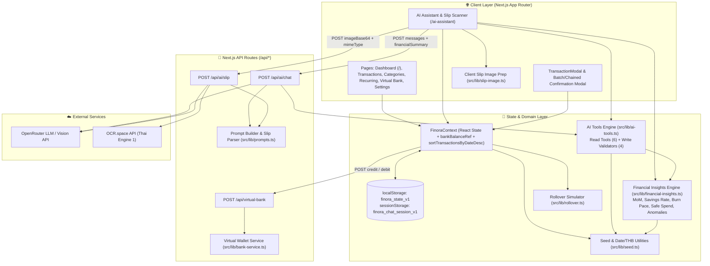
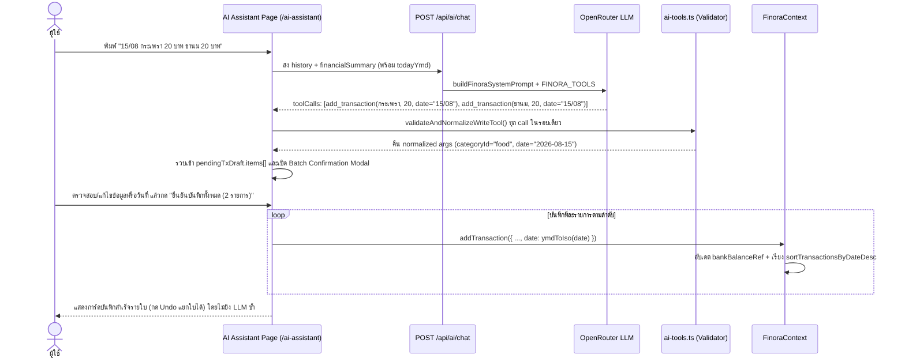

# 🗺️ System Architecture Map: Finora

> Blueprint โครงสร้างสถาปัตยกรรม ความสัมพันธ์ของโมดูล และ Data Flow ของโปรเจกต์ **Finora (AI Personal Finance & Income-Expense Tracker)**

---

## 1. 🏗️ Tech Stack & Core Dependencies

| Layer | Technology / Library | Purpose |
|---|---|---|
| **Framework** | Next.js 15.3 (App Router) + React 19 | Frontend UI, Client Routing, และ Server API Routes (`/api/*`) |
| **Language** | TypeScript 5.7 | Static typing ทั่วทั้ง Frontend, Domain Logic และ API |
| **Styling & Theme** | Tailwind CSS 3.4 + CSS Custom Properties (`globals.css`) | Dual Theme (`Light Fintech` / `Emerald Nocturne Dark`) และ Material Symbols Outlined |
| **State & Persistence** | React Context (`FinoraContext`) + `localStorage` / `sessionStorage` | เก็บสถานะธุรกรรม (`finora_state_v1`) และประวัติแชทแยกตามอีเมลผู้ใช้ (`finora_chat_session_v1:<email>`) |
| **AI / LLM Gateway** | OpenRouter API (`src/lib/openrouter.ts`) | Chat Completions, Multi-Tool Function Calling, และ Multimodal Vision สำหรับอ่านสลิป |
| **Slip Image & OCR Pipeline** | Browser Canvas (`src/lib/slip-image.ts`) + OCR.space Engine 1 (`src/lib/ocr.ts`) | เตรียม/ย่อขนาดรูปสลิปฝั่ง Client (`<= 950KB` ส่งตรง / `1600px`) ควบคู่กับ OCR ภาษาไทยฝั่ง Server |
| **Testing** | Node.js Native Type-Stripping (`src/lib/self-check.ts`) | ชุดทดสอบ Deterministic Unit & Integration (`npm run test:check`) 30 หมวดตรวจสอบ |

---

## 2. 🚪 Primary Entry Points

- **Root App Bootstrap:** [src/app/layout.tsx](file:///c:/Gitwork/Finora/src/app/layout.tsx) — โหลดฟอนต์, Material Symbols, และครอบแอปด้วย `<FinoraProvider>`
- **Authenticated App Shell:** [src/app/(app)/layout.tsx](file:///c:/Gitwork/Finora/src/app/(app)/layout.tsx) → [src/components/AppShell.tsx](file:///c:/Gitwork/Finora/src/components/AppShell.tsx) — ตรวจสถานะล็อกอิน, แสดง Sidebar (พร้อมยอด `Virtual Wallet`), Topbar, และ `<TransactionModal />`
- **Authentication Routes:** [src/app/(auth)/login/page.tsx](file:///c:/Gitwork/Finora/src/app/(auth)/login/page.tsx), [register/page.tsx](file:///c:/Gitwork/Finora/src/app/(auth)/register/page.tsx), [forgot-password/page.tsx](file:///c:/Gitwork/Finora/src/app/(auth)/forgot-password/page.tsx) (ครอบด้วย [src/components/AuthShell.tsx](file:///c:/Gitwork/Finora/src/components/AuthShell.tsx))
- **Server API Endpoints:**
  - `POST /api/ai/chat` ([src/app/api/ai/chat/route.ts](file:///c:/Gitwork/Finora/src/app/api/ai/chat/route.ts)) — สร้าง System Prompt (`buildFinoraSystemPrompt`) และเรียก OpenRouter พร้อม `FINORA_TOOLS`
  - `POST /api/ai/slip` ([src/app/api/ai/slip/route.ts](file:///c:/Gitwork/Finora/src/app/api/ai/slip/route.ts)) — รัน Hybrid OCR (`extractSlipOcrText`) + Vision LLM (`buildSlipPrompt` → `parseSlipResult`)
  - `GET | POST /api/virtual-bank` ([src/app/api/virtual-bank/route.ts](file:///c:/Gitwork/Finora/src/app/api/virtual-bank/route.ts)) — ประมวลผลการเพิ่ม/ลดยอด Virtual Wallet ผ่าน `executeBankTransfer`
- **Verification Entry Point:** [src/lib/self-check.ts](file:///c:/Gitwork/Finora/src/lib/self-check.ts) (`npm run test:check`)

---

## 3. 🧩 Architecture & Data Flow (Mermaid)

### 3.1 High-Level Component & Layer Architecture

### 3.2 AI Chat Multi-Tool & Batch Confirmation Flow

---

## 4. 📂 Directory & Module Responsibilities

| Path | Primary Responsibility |
|---|---|
| `src/app/(app)/page.tsx` | หน้า **ภาพรวมการเงิน (Dashboard)**: การ์ดสรุป 4 มิติ, AI Insights, กราฟแท่ง 6 เดือน, สัดส่วนรายจ่ายตามหมวดหมู่ และรายการล่าสุด |
| `src/app/(app)/ai-assistant/page.tsx` | หน้า **ผู้ช่วย AI & สแกนสลิป**: ระบบแชท Markdown, `runToolLoop`, สแกนรูปสลิปด้วย OCR + Vision AI, และ **Batch/Chained & Budget Update Blocking Confirmation Modals** |
| `src/app/(app)/transactions/page.tsx` | หน้า **รายรับรายจ่ายทั้งหมด**: ค้นหา/กรองธุรกรรม, แก้ไขวันที่แบบ Inline (`<input type="date">`), และลบรายการ |
| `src/app/(app)/categories/page.tsx` | หน้า **จัดการหมวดหมู่**: แยกแท็บหมวดรายจ่าย/รายรับ, ตั้งงบประมาณรายเดือน, สร้างหมวดหมู่กำหนดเองพร้อมสีไม่ซ้ำ |
| `src/app/(app)/recurring/page.tsx` | หน้า **ตัด/รับเงินอัตโนมัติ (Recurring)**: จัดการทั้งรายจ่ายประจำและรายรับประจำ (เช่น เงินเดือน), สั่งตัด/รับยอดทันทีรายตัวหรือทั้งหมด |
| `src/app/(app)/virtual-bank/page.tsx` | หน้า **ธนาคารจำลอง (Virtual Bank)**: ฟอร์มจำลองฝาก/โอนเงิน และตารางรายการเดินบัญชี (Ledger) |
| `src/app/(app)/settings/page.tsx` | หน้า **ตั้งค่าระบบ**: โปรไฟล์, สลับธีม, ตั้งค่าตัดเงินอัตโนมัติ, วันรีเซ็ตโควต้า, จำลองวันครบรอบเดือน (Rollover Simulator), และตั้งค่า OpenRouter API Key |
| `src/components/AppShell.tsx` | โครงหน้าหลักหลังล็อกอิน: Sidebar พับย่อได้, กล่องแสดงยอด `Virtual Wallet` (ไฮไลต์สีเมื่อติดลบ), และ Topbar ร่วมกันทุกหน้าผ่าน `DashboardHeader` |
| `src/components/ConfirmDialog.tsx` | Dialog ยืนยันแบบ Reusable พร้อม `useDialogAccessibility` (ใช้ในล้างแชท, ลบธุรกรรม/หมวดหมู่/บิล ฯลฯ) |
| `src/components/IconColorPicker.tsx` | ป๊อปโอเวอร์เลือกไอคอน Material Symbol และสีหมวดหมู่ (ใช้ทั้งใน `/categories` และการ์ด/Modal `add_category` ในแชท) |
| `src/components/TransactionModal.tsx` | ป๊อปอัป **"บันทึกธุรกรรมใหม่"** แบบ Manual พร้อมตัวเลือกหมวดหมู่ ช่องทาง และวันที่ทำรายการ (`<input type="date">`) |
| `src/components/dashboard/DashboardShell.tsx` | `DashboardHeader`: Top Navigation Bar ร่วมทุกหน้า (ปุ่มบันทึกด่วน, สลับ Dark/Light Mode, กระดิ่งแจ้งเตือนงบ/บิล, เมนูโปรไฟล์เหลือเฉพาะปุ่มออกจากระบบ ไม่มี search bar) |
| `src/components/dashboard/SummaryCards.tsx` | การ์ดสรุป 4 ใบ (รายรับรวม, รายจ่ายรวม, คงเหลือสุทธิ, งบประมาณคงเหลือ พร้อมป้ายจำนวนหมวดและรอบงบปัจจุบัน) |
| `src/components/dashboard/IncomeExpenseChart.tsx` | กราฟแท่งเปรียบเทียบรายรับ-รายจ่าย (สลับดูรายเดือน / รายสัปดาห์ / รายปี) |
| `src/components/dashboard/RecentTransactionsCard.tsx` | การ์ดแสดงรายการธุรกรรมล่าสุดในช่วงเวลาที่เลือกบน Dashboard |
| `src/components/dashboard/AiInsightsCard.tsx` | การ์ดวิเคราะห์คำแนะนำการเงินอัตโนมัติ (AI Insights) เชื่อมไปยัง `/ai-assistant` |
| `src/components/dashboard/BudgetOverviewCard.tsx` | การ์ดแสดงสัดส่วนการใช้งบครบทุกหมวดหมู่ที่มีงบ พร้อมแถวสรุปรวมยอดท้ายการ์ด |
| `src/components/dashboard/ExpenseBreakdownCard.tsx` | กราฟโดนัทแสดงสัดส่วนรายจ่ายสูงสุด 5 อันดับ (หากเกิน 5 หมวด จะรวบเป็นหมวด "อื่นๆ") |
| `src/components/dashboard/dashboard-utils.ts` | ฟังก์ชันคำนวณ Dashboard (`resolveDateRange`, `computePeriodSummary`, `buildSparklineSeries`, `buildBarChartSeries`, `computeBudgetOverview`, `computeExpenseBreakdown`, `buildDashboardInsights`, `buildDashboardNotifications`) |
| `src/context/FinoraContext.tsx` | ศูนย์กลาง State ของแอป: จัดการ Transactions (เรียงวันที่ล่าสุดขึ้นก่อนเสมอ), Categories, Recurring, Virtual Wallet (`bankBalanceRef`, `txSeqRef`, `catSeqRef`), และ Chat Session |
| `src/lib/ai-handoff.ts` | จัดการ one-shot prompt Handoff ผ่าน `sessionStorage` จากการ์ด AI Insights บน Dashboard ไปส่งถามอัตโนมัติใน `/ai-assistant` |
| `src/lib/ai-tools.ts` | นิยาม `FINORA_TOOLS` (6 Read Tools รวม `get_spending_insights` ที่รองรับการกรอง `sections` + 4 Write Tools: `add_transaction`, `update_category_budget`, `add_category`, `add_recurring_payment`), `CATEGORY_ALIASES`, `resolveCategory` (ตรวจชื่อหมวดตรงตัวก่อน alias), และ `validateAndNormalizeWriteTool` |
| `src/lib/financial-insights.ts` | Pure Analytics Engine (`computeFinancialInsights`, `formatCompactInsightsForPrompt`, `toMonthlyRecurringAmount`) คำนวณ MoM %, อัตราการออม, Burn Pace เทียบวันของเดือน, Daily Safe Spend, Recurring Load %, หมวดพุ่งผิดปกติ, รายการใหญ่สุด, และเป้าหมายประหยัดจำลองแบบไดนามิกพร้อม `sampleTransactions` |
| `src/lib/prompts.ts` | `FINORA_PROMPT_VERSION = "2.10.0"`, `buildFinoraSystemPrompt` (3-Tier Coaching Scope + Summary Follow-up Advice + Anti-Vague Rule + Light Proactivity), `buildSlipPrompt`, และ `parseSlipResult` (จับคู่ชื่อผู้โอน/ผู้รับกับชื่อผู้ใช้เพื่อแยก `income`/`expense`) |
| `src/lib/bank-service.ts` | Pure function `executeBankTransfer` สำหรับคำนวณยอด `bankBalance` (อนุญาตให้ติดลบได้) และสร้าง `BankLedgerEntry` |
| `src/lib/rollover.ts` | `simulateRolloverToDate` จำลองเหตุการณ์การเงินตามลำดับเวลา: รีเซ็ตโควต้า → รับรายรับประจำ → ตัดบิลรายจ่ายประจำ (ตัดยอดแม้ติดลบ) |
| `src/lib/seed.ts` | ข้อมูลตั้งต้น 3 เดือน (`INITIAL_*` พร้อม `INITIAL_USER`: `นายรัชชานนท์ แก้วกูล`), ตัวจัดรูปแบบ `formatTHB` (รองรับ `-฿...`), `formatThaiDate`, ตัวค้นหาวันที่ (`matchesTransactionDateQuery`), ตัวจัดการวันที่ (`todayYmd`, `ymdToIso`, `toDateInputValue`, `normalizeTransactionDate`), และ `isInCurrentQuotaCycle` |
| `src/lib/ocr.ts` | `extractSlipOcrText` เรียก OCR.space Engine 1 (`language: "tha"`) พร้อม timeout 4 วินาที และจำกัดขนาดไฟล์ 1 MB |
| `src/lib/openrouter.ts` | `callOpenRouter` HTTP client พร้อม timeout 45 วินาที, รองรับ `maxTokens` + จับ `finish_reason === "length"`, Auto-Retry 2 ครั้ง (`1s`/`2s`) สำหรับ `429/502/503/504` หรือ network error ชั่วคราว, และตัวเก็บสถิติ `LLMMetrics` |
| `src/lib/slip-image.ts` | เตรียมรูปภาพสลิปสำหรับ OCR/Vision API (`prepareSlipImage`: ส่งตรง `<= 950KB`, ย่อ `1600px` ให้อยู่ใต้ลิมิต OCR 1 MB, และสร้าง thumbnail `180px`) |
| `src/lib/types.ts` | TypeScript interfaces กลาง (`Category`, `Transaction`, `RecurringPayment`, `BankLedgerEntry`, `AppSettings`, `ChatMessage`) |
| `src/lib/useDialogAccessibility.ts` | Custom hook จัดการ Escape key, Focus Trap, คืน Focus และ Lock Background Scroll สำหรับ Blocking Modals |
| `src/lib/self-check.ts` | ชุดทดสอบอัตโนมัติ 30 หัวข้อครอบคลุมทุกฟังก์ชันหลักใน `src/lib/` (รวม analytics, `sections`, `sampleTransactions`, date search, seed integrity, และ prompt v2.10.0) |

---

## 5. ⚠️ Gotchas & Non-Obvious Conventions

1. **Virtual Wallet อนุญาตให้ยอดติดลบได้ทุกกรณี (Negative Balance Policy):**
   - Finora ทำหน้าที่เป็นแอปบันทึกรายรับ-รายจ่ายที่รวมยอดเงินสุทธิไว้ใน `bankBalance` (รวมถึงช่องทาง `"เงินสด"`)
   - ไม่มีเงื่อนไขบล็อก `amount > bankBalance` ทั้งใน `executeBankTransfer`, `validateAndNormalizeWriteTool`, `VirtualBankPage`, และ `simulateRolloverToDate` (บิลรายจ่ายประจำจะถูกตัดตามกำหนดเสมอแม้ยอดเงินจะติดลบ)
2. **การป้องกัน Stale Closure เมื่อบันทึกแบบ Batch (`bankBalanceRef`, `txSeqRef` & `catSeqRef`):**
   - ใน `FinoraContext.tsx` การเรียก `await addTransaction(...)` หรือ `addCategory(...)` ติดต่อกันหลายครั้งในลูปเดียว (เช่น กดยืนยัน Batch/Chained Modal) ต้องอ่านและอัปเดตยอดผ่าน `bankBalanceRef.current` แบบ Synchronous ทันทีที่ `/api/virtual-bank` ตอบกลับ และใช้ `txSeqRef.current` / `catSeqRef.current` ต่อท้าย `id`/`ref` เพื่อไม่ให้ยอดเงินถูกเขียนทับหรือเกิด React key ซ้ำ
3. **การป้องกันปัญหา Timezone เลื่อนวัน (`ymdToIso` & `normalizeTransactionDate`):**
   - วันที่ของธุรกรรมที่ผู้ใช้หรือ AI ระบุ (`YYYY-MM-DD`, `DD/MM`, `DD/MM/YYYY` ทั้ง ค.ศ. และ พ.ศ.) จะถูกแปลงเป็น `YYYY-MM-DD` แล้วบันทึกในรูปแบบ `${ymd}T12:00:00+07:00` (`ymdToIso`) เสมอ เพื่อไม่ให้การแปลง UTC/Local Time เลื่อนวันข้ามคืน
   - ทุกครั้งที่มีการเพิ่มรายการ, แก้ไขวันที่ (`updateTransactionDate`), หรือจำลอง Rollover รายการธุรกรรมจะถูกเรียงลำดับด้วย `sortTransactionsByDateDesc` (วันที่ล่าสุดอยู่บนสุด)
4. **การป้องกัน AI วนลูปเมื่อสั่งหลายรายการ & การสร้างหมวดพ่วงรายการ (`runToolLoop` Batching & Chaining):**
   - เมื่อ LLM ส่ง `add_transaction` หลายรายการ หรือส่ง `add_category` พร้อม `add_transaction` ในรอบเดียวกัน `runToolLoop` ใน `src/app/(app)/ai-assistant/page.tsx` จะจำลองหมวดใหม่ด้วย `draft-cat-*` ใน `workingCategories` แล้วรวบเข้า **Batch/Chained Confirmation Modal** เดียว (สร้างหมวดหมู่ก่อนแล้วค่อยบันทึกรายการด้วย ID จริงแบบ atomic และไม่ยิงเรียก LLM ซ้ำหลังผู้ใช้กดยืนยัน)
5. **หมวดหมู่สงวน `"recurring"` (Reserved Category):**
   - หมวด `id: "recurring"` ใช้สำหรับรายการตัดบิลอัตโนมัติและคำนวณงบอัตโนมัติผ่าน `syncCategoriesWithRecurring` เท่านั้น ห้ามให้ผู้ใช้หรือ AI เลือกหรือสร้างหมวดนี้ใน `add_transaction`, `update_category_budget`, `add_category`, หรือ `parseSlipResult`
6. **Quota Cycle Fallback เป็นเดือนปัจจุบัน (`isInCurrentQuotaCycle`):**
   - หากผู้ใช้ยังไม่เคยรีเซ็ตรอบโควต้า (`quotaResetAt` ยังไม่ถูกตั้งค่า) `isInCurrentQuotaCycle` ใน `src/lib/seed.ts` จะนับเฉพาะธุรกรรมที่อยู่ในเดือนปฏิทินปัจจุบัน (`YYYY-MM`) เพื่อให้ยอดงบประมาณใน Dashboard, `/categories`, แจ้งเตือน, และ AI Context ไม่สะสมยอดย้อนหลังข้ามเดือน
7. **Environment Variables (`.env.local`):**
   - `OPENROUTER_API_KEY` (จำเป็นสำหรับ AI Chat และ Vision; หรือใส่ Override Key ได้ในหน้า Settings ของแอป)
   - `OPENROUTER_MODEL` (ค่าเริ่มต้น `nvidia/nemotron-3.5-super-vl:free`)
   - `OCR_SPACE_API_KEY` (ไม่บังคับ — หากมีจะช่วยสกัดข้อความภาษาไทยจากสลิปส่งเสริมให้ Vision LLM แม่นยำขึ้น หากไม่มีหรือเกิน 4 วินาที ระบบจะ fallback ไปใช้ Vision LLM ล้วนโดยไม่พัง)
